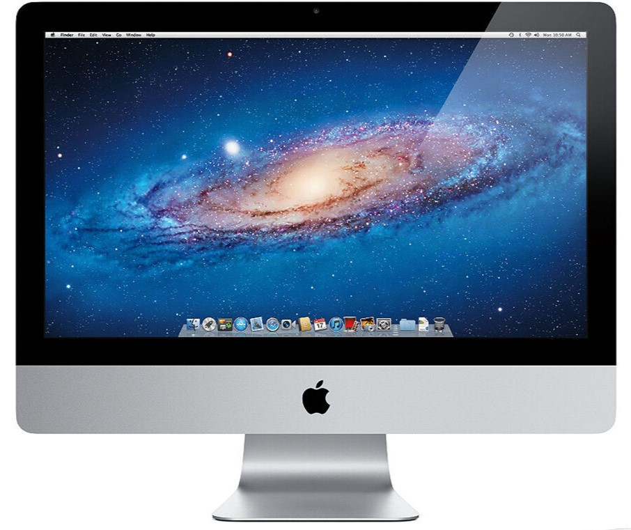

# homelab v2

| Part | Order Status |
|---|---|
| [Sysracks 15U Wall Mount Server Rack Cabinet 24” Deep](https://a.co/d/06zSUiVo) | Received / Pending Assembly |
| [Network Switch](https://a.co/d/0cgy1F8x) | Received |
| Mini PC's | Notre Dame Surplus - Waiting |
| PDU (included w/ Case) | Received |
| UPS | Undecided |
| Patch Panel | Cart |
| Keystones, Couplers, & Cables | Cart|
| NAS - 18" Depth Rackmount | Still Looking For Used  / Saving Up |
| HDD Storage x4 | Bulk / Price Drop | 
| Govee LED Strip | Pending | 
| iMac Terminal | Recycled |

# Homelab Rack Layout

| Unit | Equipment |
|:---:|---|
| U15 | Empty |
| U14 | Shelf |
| U13 | Patch Panel |
| U12 | Patch Panel |
| U11 | Network Switch |
| U10 | PC / Server |
| U9 | NAS |
| U8 | NAS |
| U7 | Reserved |
| U6 | Reserved |
| U5 | PC / Server |
| U4 | Empty |
| U3 | Shelf |
| U2 | UPS |
| U1 | PDU |

# Display Terminal

Decided to repurpose a mid 2011 21" iMac into a Display Terminal for the homelab.
Will gut the logic board and replace it with a display controller w/ HDMI, etc. 
Ordered iFixit suction cups; will arrive tomorrow. Once the screen is removed (strong magnets) and 
I can get the LCD model number, I can then order the specific video controller and complete the conversion. 
The display will also play an aesthetic role within my setup. Oftentimes playing television,
film, music videos, nature videos, anime, just anything for aesthetic that's on my NAS.  
I have also decided to run Ubuntu w/ KDE, for homelab functionality, and for the fact that I can
make the OS's GUI take the appearance of Mac OS X Lion. With the iconic Galaxy Wallpaper, Dock, etc., it just
makes it all that much better.

Got the suctions cups and LCD model number, everything went smoothly. 
Found a Display Controller on AliExpress with an HDMI & DP, which is a nice surprise,
and will make this that much more useful.
I have messaged seller to confirm specs, and will order once I get confirmation. 
